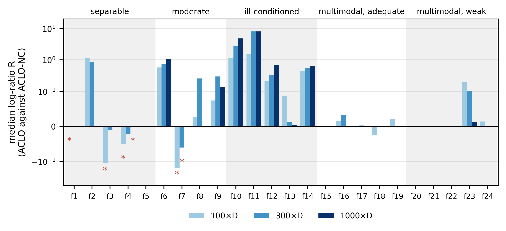
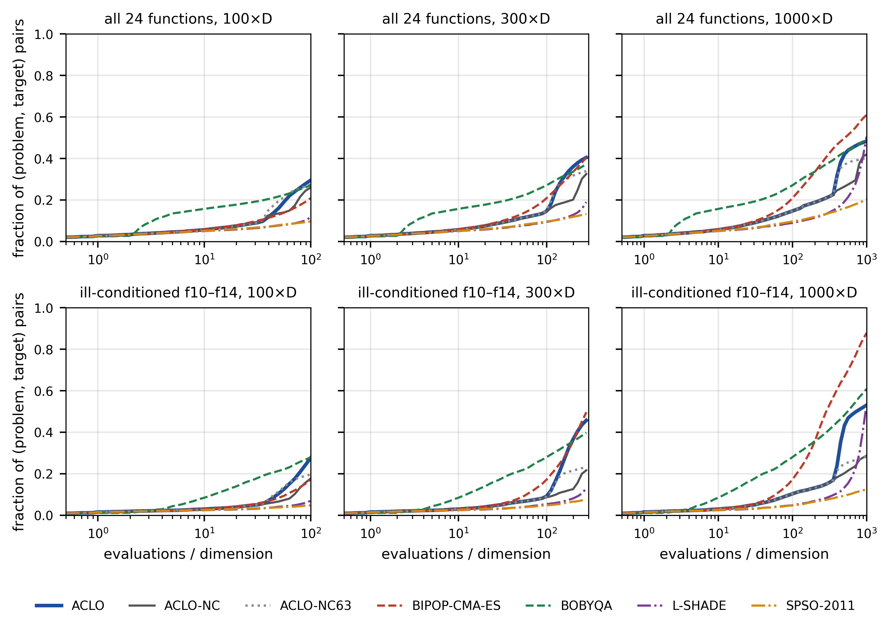

# ACLO: Anchored Curvature-Learning Optimiser

Code for the paper *Derivative-free optimisation with curvature learned from already-paid evaluations for budget-limited engineering model calibration* by Md. Rashedul Islam (Department of Computer Science and Engineering, IUBAT, Dhaka, Bangladesh). The manuscript is in preparation; the citation will be added here.

## What ACLO does

ACLO is a derivative-free optimiser for bounded continuous problems in which every evaluation is expensive, for example the calibration of a simulation model.

- **Base search (ACLO-NC).** A two-stage search: stage 1 samples new points around a small archive of good points (anchors); stage 2 refines the best points with line probes, each of which evaluates the objective at three points on a straight line and steps to the minimum of a one-dimensional quadratic.
- **Curvature sensing.** For a quadratic, the second divided difference of the three values of a line probe along a unit direction `u` equals `u^T H u` exactly, at any position and step length. ACLO stores these values; it spends no extra evaluation on them.
- **Metric fit.** A symmetric matrix `M` is fitted to all stored curvature values by weighted least squares (relative errors, an isotropic prior, ageing of old values).
- **Skill gate.** Each new curvature value is predicted by the current fit before it is added. The eigenvectors of `M` steer the line probes only while the fit predicts new values clearly better than an isotropic model (median error at most 0.75 times that of the isotropic model to open, above 0.9 times to close).
- **Budget split.** ACLO gives 63% of the budget to the line-probe stage.

## Contents

| Path | Content |
| --- | --- |
| `src/aclo.py` | ACLO: the base search with curvature learning; function `minimize` |
| `src/aclo_nc.py` | ACLO-NC: the base search without curvature learning; function `minimize` |
| `src/curvature_frame.py` | Curvature sensing, metric fit, skill gate and frame-directed probe lines |
| `src/local_models.py` | Optional surrogate models of the base search (switched off in every reported run) |
| `src/competitors.py` | BIPOP-CMA-ES (pycma), BOBYQA (NLopt), L-SHADE and SPSO-2011, with the settings of the paper |
| `src/budget.py` | The `BudgetReached` exception used by the competitors |
| `src/applications.py` | Application problems: alpha-pinene kinetics; GR4J with snow and HBV on CAMELS basin 01031500 |
| `results/` | Result tables of the two experiments of the paper; each file is described in `results/README.md` |
| `figures/` | Figures of the paper as PNG (400 dpi) and PDF files; each file is described in `figures/README.md` |

## Installation

Python 3.10 or later.

```bash
pip install numpy scipy pandas numba cma nlopt
```

`numba` is optional and only speeds up the hydrological models; `cma` and `nlopt` are needed only for the competitors.

## Usage

```python
import sys
sys.path.insert(0, 'src')

import numpy as np
from aclo import minimize

def f(x):                       # any function of a 1-D NumPy array
    w = np.logspace(0, 6, x.size)
    return float(np.sum(w * (x - 0.3) ** 2))

D = 10
bounds = [(-5.0, 5.0)] * D
res = minimize(f, bounds, budget=100 * D, population=32, seed=1,
               geometry_mode='frame', geometry_options={'gate_mode': 'skill'},
               scan_frac_override=0.63)
print(res.fun, res.nfev)        # best value and evaluations used
print(res.x)                    # best point
```

The three versions compared in the paper are called as follows.

| Version | Call |
| --- | --- |
| ACLO | `aclo.minimize(f, bounds, budget, population=32, seed=s, geometry_mode='frame', geometry_options={'gate_mode': 'skill'}, scan_frac_override=0.63)` |
| ACLO-NC (base search) | `aclo_nc.minimize(f, bounds, budget, population=32, seed=s)` |
| ACLO-NC63 (base search with the 63% split) | `aclo.minimize(f, bounds, budget, population=32, seed=s, geometry_mode='off', scan_frac_override=0.63)` |

The budget must be at least twice the population size. Every call of `f`, including the evaluation of a candidate that is later rejected, counts against the budget. `res.diagnostics` reports, among other values, when the skill gate first opened.

### Application problems

```python
from applications import make_problem

p = make_problem('pinene')                       # 5 rate constants, SSE objective
res = minimize(p.f, p.bounds, budget=100 * p.dim, population=32, seed=1,
               geometry_mode='frame', geometry_options={'gate_mode': 'skill'},
               scan_frac_override=0.63)
```

The hydrological problems need the CAMELS files of basin 01031500, which are part of the RRMPG repository:

```bash
git clone --depth 1 https://github.com/kratzert/RRMPG.git camels_data/RRMPG
```

```python
p = make_problem('gr4jcn', 'camels_data')        # GR4J with snow, 6 parameters, objective 1 - KGE
q = make_problem('hbv', 'camels_data')           # HBV, 14 parameters, objective 1 - KGE
```

## Settings used in the paper

| Item | Setting |
| --- | --- |
| Benchmark | COCO/BBOB, 24 noiseless functions, D = 2, 3, 5, 10, 20, 40, instances 1-5 and 71-80 |
| Budgets | 100, 300 and 1000 evaluations per dimension |
| ACLO | population 32, `geometry_mode='frame'`, `gate_mode='skill'`, `scan_frac_override=0.63`, all other options at their defaults |
| Applications | 25 runs per method and budget; warm-up 1980-10-01 to 1981-09-30, calibration to 1996-09-30, validation to 2010-09-30 |

## Main results

| Result | Value |
| --- | --- |
| Pre-registered criteria (ACLO against ACLO-NC) | All five passed |
| Ill-conditioned functions f10-f14, final error against ACLO-NC | 3.2, 4.2 and 6.6 times smaller at 100, 300 and 1000 x D |
| Held-out instances, f10-f14, 1000 x D | 6.5 times smaller (95% interval of the median log-ratio 0.65 to 0.99) |
| Share of targets reached at 100 x D | ACLO 0.296; best other method 0.271 |
| 1000 x D | BIPOP-CMA-ES ahead (0.611 against 0.483) |
| Applications, 30 pre-registered tests | ACLO better in 19, equal in 9, worse in 2 |

The tables behind these values are in `results/`: `bbob_preregistered_criteria.json` holds the five criteria with their observed values, and `app_ranksum_tests.csv` holds the 30 primary and 15 secondary tests of the applications with Holm-adjusted p-values and A12 effect sizes.

The gain of curvature learning is concentrated on the ill-conditioned functions f10-f14, while ACLO loses small amounts on a few separable and moderate functions (f1, f3, f4 and f7), mainly at 100 and 300 x D (Figure 2 of the paper):



Against the four external methods, ACLO reaches the largest share of targets at 100 x D, while BIPOP-CMA-ES leads at 1000 x D (Figure 3 of the paper):



## Status of this release

The files in `src/` are the code that produced the results of the paper, with identifiers, comments and messages renamed to the names used in the paper. The renaming used a one-to-one map of identifiers. A mechanical check mapped every renamed identifier back and compared the result with the code used in the experiments: apart from comments, docstrings, one error message and the import of `BudgetReached` (now from `src/budget.py`), every line is identical. Please report any problem as an issue.

## Data

- alpha-pinene isomerisation: Fuguitt and Hawkins (1947), *J. Am. Chem. Soc.* 69, 319-322, as analysed by Box et al. (1973), *Technometrics* 15, 33-51. The data are included in `src/applications.py`.
- CAMELS: Newman et al. (2015), *Hydrol. Earth Syst. Sci.* 19, 209-223; Addor et al. (2017), *Hydrol. Earth Syst. Sci.* 21, 5293-5313. Files from the RRMPG repository by F. Kratzert (MIT licence).

## Licence

MIT; see `LICENSE`.
